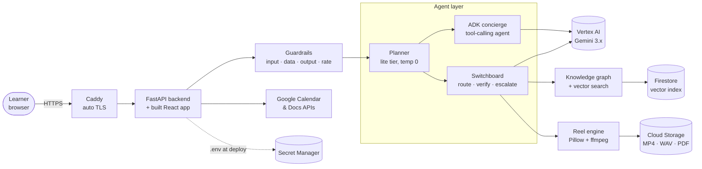
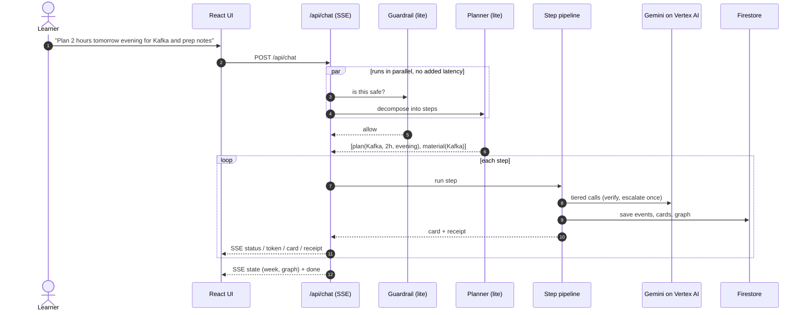
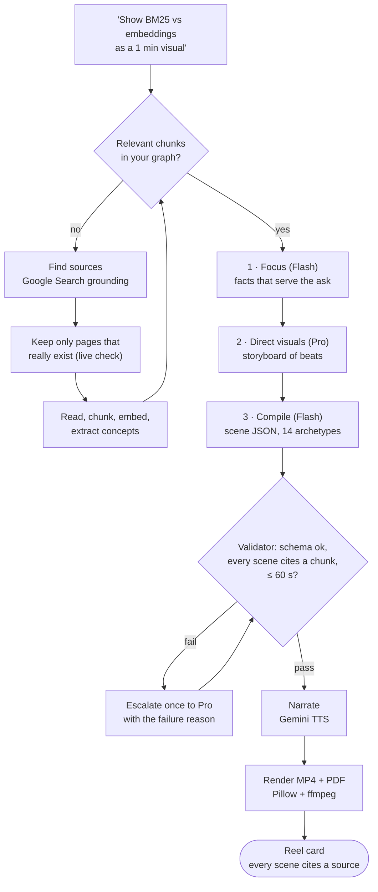

<div align="center">

# Recal

**The study plan that survives contact with your week.**

Recal is an AI learning agent for busy professionals. It turns *"I need to understand X before Thursday"*
into booked study time, a 60-second animated explainer, a page-by-page study book,
and a mock client meeting. Every answer is grounded in real sources and cited.


[Full documentation](docs/DOCUMENTATION.md) ·
[Deployment guide](deploy/README.md)

Built on **Gemini 3.x on Vertex AI** · **Google ADK** · **Firestore vector search** ·
**Cloud Storage** · **Secret Manager** · **Compute Engine** · **Google Calendar & Docs APIs**

</div>

---

## The problem

Professionals don't fail to learn because content is scarce. They fail because learning
never makes it into the calendar, and when it does, it's the first thing an urgent meeting
erases. Chatbots answer questions, but they don't plan, they don't adapt when the week
falls apart, and they don't check that you can explain the idea to a client.

## What Recal does

| | Feature | What happens |
|---|---|---|
| 🎬 | **60-second visual reels** | "Show BM25 vs embeddings as a 1 min visual" produces a narrated, animated 6-scene explainer built from real web sources, downloadable as MP4 or PDF slides. |
| 📅 | **Managed study sessions** | "Plan 2 hours tomorrow evening for Kafka" books free slots around your real Google Calendar and prepares a page-by-page study book sized to the session. |
| 🔁 | **Renegotiation** | "Urgent meeting" or "I'm tired" re-plans the week. Sessions are moved, shrunk or dropped, never silently lost. |
| 📚 | **Grounded notes and Q&A** | Notes and answers come from your captured sources, with chunk-level citations, and pass a critic review before you see them. |
| 🧑‍💼 | **AI client** | Upload a PPTX, DOCX or XLSX. Recal reviews whether it lands its message and whether it's client-ready, then runs a voice mock meeting that probes the weak spots. |
| 🧠 | **Learns your style** | 👍 or 👎 on any output is distilled into a teaching-style memory, embedded and recalled for related topics. |

## Architecture



**Three Gemini tiers, chosen per task by the Switchboard:**

| Tier | Model | Used for |
|---|---|---|
| lite | `gemini-3.5-flash-lite`, temperature 0 | intent routing, safety guard, style tagging |
| fast | `gemini-3.8-flash` | chat, reel scripts, study pages, doc review, concierge agent |
| deep | `gemini-3.1-pro-preview` | study planning, reel visual direction, retries after a failed check |
| tts | `gemini-3.8-flash-tts` | reel narration (offline voice as fallback) |
| embed | `gemini-embedding-001` (768-d) | knowledge graph and style memory |

## How a request flows

One chat box drives everything. A lite-tier planner splits each message into steps, and
each step runs a verified pipeline.



Every model output carries a **receipt**: which model ran, its thinking level, whether it
passed verification, and whether it was escalated to Pro. That makes the AI's work auditable
in the UI.

## How a reel is made



If search is blocked, Recal falls back from Google grounding to a keyless web search, then
to Wikipedia, and finally to the model's own knowledge. That last fallback is labeled
*"Model knowledge"* on the card, so its provenance stays visible.

## Why it's robust

- **Verified, not trusted:** schedules can only use slot IDs the calendar actually returned.
  Reel scenes must cite existing chunks, and study pages must carry citations. Failures are
  retried once on Pro with the reason attached.
- **Never a dead end:** every pipeline has a deterministic fallback, such as extractive
  reels, a heuristic deck review or canned meeting questions. A model outage degrades the
  output instead of crashing the request.
- **Resilient calls:** 429 and 503 errors are retried with backoff. A 90-second per-call
  deadline turns stalled requests into fast retries instead of minutes of waiting.
- **Secure by design:**
  - Four guardrail layers: a model-judged input guard, untrusted-data tagging against
    prompt injection, secret redaction on every output, and per-user rate limits.
  - OAuth tokens are encrypted at rest with AES-256-GCM, and Firestore denies all client access.
  - No API keys on the server: it authenticates as its service account.
  - **Every visitor is private:** each browser gets its own random guest ID, so judges
    never see each other's chats, videos, calendar or uploads.

## Run it locally

Requires Python 3.11+, Node 22+, and either a Google Cloud project or nothing at all (mock mode).

```bash
# backend
python -m venv .venv && .venv/Scripts/activate        # macOS/Linux: source .venv/bin/activate
pip install -r requirements.txt
cp .env.example .env            # set GOOGLE_CLOUD_PROJECT, or leave it blank for mock mode
gcloud auth application-default login                 # only needed for real mode
uvicorn backend.main:app --reload --port 8000

# frontend (second terminal)
cd frontend && npm install && npm run dev             # http://localhost:5173
```

**Mock mode** (no `GOOGLE_CLOUD_PROJECT`) runs every feature on canned output: no keys and
no cost. **`GET /api/health?live=1`** makes one real call per model and reports what's ready.

## Deploy to Google Cloud

One VM, HTTPS out of the box, secrets from Secret Manager, no logs on disk:

```bash
git clone https://github.com/Chaitanya674/Recal-AI.git recal && cd recal
bash deploy/vm_install.sh       # prints https://<ip>.sslip.io when ready
```

See **[deploy/README.md](deploy/README.md)** for the full checklist: project setup, IAM,
Firestore indexes, OAuth and submission.

## Project structure

```
backend/
  main.py            FastAPI app, rate-limit + logging middleware, serves the built frontend
  router/            HTTP API: chat (SSE), auth/connect, docs, meeting, reels, health
  agents/            ADK agent factory + free-form concierge (tools over graph & calendar)
  features/          llm (Switchboard), intents, knowledge, motion (reels), render,
                     material, calendar, documents, meeting, rehearse, memory, google
  database/          Firestore access (fire), schema paths, graph + vector store
  helper/            config, guardrails, prompts.yml (all prompts), logger, diagnostics
frontend/src/        React 19 + Vite: chat, Canvas (reels/books), Week, Cards, Practice
deploy/              gcp_setup.sh, vm_install.sh, start.sh, deployment checklist
docs/                DOCUMENTATION.md: architecture, flows, data model, API
```

## Tested

The full API suite runs against real Gemini: health, chat, planning, reel → PDF/MP4, Q&A,
study notes, document upload and review, and the mock meeting. It passes 16/16.

| Flow | Typical time |
|---|---|
| Q&A from your graph | ~7 s |
| Plan study time | ~8 s |
| Reel, including finding and reading sources | 2–3 min |
| Reel → MP4 / PDF | ~20 s / ~2 s |
| Study book (multi-page, with critic) | ~3 min |

## Known limitations

- There's no account sign-in yet. Each browser gets its own private guest profile, so
  clearing cookies or switching browsers starts a fresh one.
- The Google OAuth app is unverified, so Calendar and Docs connect shows Google's
  "unverified app" screen (*Advanced → Go to Recal*).
- One backend process: OAuth state and graph caches are in-process, sized for a demo and
  not for scale.

## License

[MIT](LICENSE) © 2026 Recal contributors
