# Recal: Technical Documentation

> Architecture, flows, data model and API reference for Recal, an AI learning agent built on
> Gemini 3.x (Vertex AI), Google ADK and Firestore. For the product overview see the
> [README](../README.md); for deployment see [deploy/README.md](../deploy/README.md).

## Contents

1. [System overview](#1-system-overview)
2. [Architecture](#2-architecture)
3. [Request lifecycle: one chat door](#3-request-lifecycle-one-chat-door)
4. [The Switchboard: model routing and verification](#4-the-switchboard-model-routing-and-verification)
5. [Knowledge graph and source acquisition](#5-knowledge-graph-and-source-acquisition)
6. [60-second visual reels](#6-60-second-visual-reels)
7. [Managed study sessions](#7-managed-study-sessions)
8. [Renegotiation and session edits](#8-renegotiation-and-session-edits)
9. [AI client: document review, mock meeting, rehearsal](#9-ai-client-document-review-mock-meeting-rehearsal)
10. [Concierge agent (Google ADK)](#10-concierge-agent-google-adk)
11. [Style memory](#11-style-memory)
12. [Google Calendar and Docs integration](#12-google-calendar-and-docs-integration)
13. [Guardrails and security](#13-guardrails-and-security)
14. [Data model](#14-data-model)
15. [Resilience and graceful degradation](#15-resilience-and-graceful-degradation)
16. [API reference](#16-api-reference)
17. [Configuration reference](#17-configuration-reference)
18. [Frontend](#18-frontend)
19. [Deployment architecture](#19-deployment-architecture)
20. [Testing and observability](#20-testing-and-observability)
21. [Limitations and roadmap](#21-limitations-and-roadmap)

---

## 1. System overview

Recal turns a learning intent into scheduled, grounded, verified study material:

| Capability | Entry point | Core modules |
|---|---|---|
| Visual reels (60 s, narrated, MP4/PDF) | chat: *"explain X visually"* | `motion`, `reel_engine`, `render`, `knowledge` |
| Study planning on the real calendar | chat: *"plan 2 hours for X"* | `calendar`, `google` |
| Study books with citations + critic | chat: *"write me notes on X"* | `material`, `knowledge` |
| Re-planning (urgent work, low energy) | quick actions / chat | `calendar` |
| Grounded Q&A | chat: a question | `knowledge`, `llm` |
| Deck/doc review, mock meeting, rehearsal | Practice tab | `documents`, `meeting`, `rehearse` |
| Learned teaching style | 👍 / 👎 on any output | `memory` |

**Design principles**

1. **One door.** Every chat message goes through `POST /api/chat`. A planner model splits it
   into ordered steps, and there is no keyword routing.
2. **Verify, don't trust.** Model output is checked by code (schemas, citations, slot IDs)
   before it is used. A failed check gets one escalation to the Pro tier with the reason.
3. **Always degrade, never die.** Every pipeline has a deterministic fallback.
4. **Grounded by construction.** Reels, notes and answers are built from ingested chunks and
   cite chunk IDs, and outside text is always marked as untrusted data.
5. **Auditable.** Every result carries a receipt (model, thinking level, verified, escalated).

---

## 2. Architecture

### 2.1 Component view

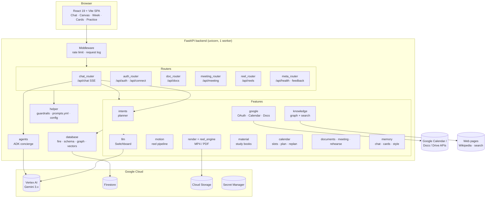

### 2.2 Layering rules

| Layer | Responsibility | Never does |
|---|---|---|
| `router/` | HTTP and SSE framing, user resolution (cookie), card emission | business logic |
| `features/` | pipelines: plan, reel, notes, review, ingest | HTTP concerns |
| `features/llm.py` | the **only** module that calls Gemini (plus `knowledge.embed` via its client) | persistence |
| `database/` | the **only** module that touches Firestore and Cloud Storage | model calls |
| `helper/prompts.yml` | every prompt, versioned in one file (optional Firestore overrides) | — |

---

## 3. Request lifecycle: one chat door

### 3.1 Sequence

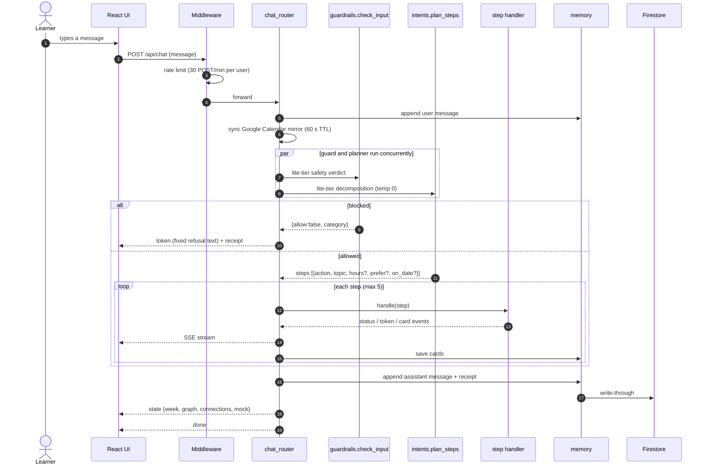

### 3.2 Planner actions

`intents.plan_steps` returns up to 5 ordered steps. Each `action` maps to one pipeline:

| action | Pipeline | Card |
|---|---|---|
| `plan` | `calendar.plan`: decompose + place into free slots | `plan` |
| `reschedule` | `calendar.edit_by_request`: verified edits | `calendar_diff` |
| `reel` | `motion.make_reel` (+ auto source acquisition) | `source`*, `reel` |
| `material` | `material.draft_material` → `review_and_revise` | `source`*, `page` |
| `answer` | `knowledge.ask` → grounded stream, or Google-Search-grounded stream | — |
| `ingest` | `knowledge.ingest_url` | `source` |
| `chat` | ADK concierge (`agents/workflow.run_freeform`) | — |

A compound turn such as *"plan 2 hours tomorrow evening and prep notes"* becomes
`plan → material`. The material is sized to the booked minutes (about one page per 15 minutes).

### 3.3 Direct actions (buttons, no planner)

`POST /api/chat {action: {type, ...}}`

| type | Effect |
|---|---|
| `bootstrap` | returns full state + history (page load) |
| `reset` | clears chat, cards and Recal sessions for the user |
| `mark_status` | marks a session done or missed; if pages remain, offers a follow-up session |
| `urgent` | inserts urgent work, then runs `replan` |
| `replan` / `energy` | renegotiates the week (`energy=tired` lightens it) |
| `export` | exports a card to a new Google Doc |

### 3.4 SSE event protocol

Events are ordered `(status | token | card)* → receipt* → state? → done`:

| event | payload |
|---|---|
| `status` | `{text}`: progress line ("Reading https://…") |
| `token` | `{delta}`: streamed prose |
| `card` | `Card {id, type, title, payload, receipt}` |
| `receipt` | `{model, thinking, verified, escalated, ms, reason}` |
| `state` | `{week, graph, connections, mock, history?}` |
| `error` | `{message, recoverable: true}`; the stream still ends with `done` |
| `done` | `{}` |

Every SSE payload passes through `guardrails.redact` before it leaves the server.

---

## 4. The Switchboard: model routing and verification

`llm.route(kind, prompt, verifier, mock_output)` is the single entry point for structured
model work. It **never raises**: callers always get either verified output or their own
deterministic fallback.

### 4.1 Tier selection

| kind | tier / thinking | kind | tier / thinking |
|---|---|---|---|
| `intent` | lite / minimal | `plan`, `replan`, `session_edit` | deep / high |
| `guard` | lite / minimal | `reel_visual_script` | deep / high |
| `style` | lite / minimal | `reel_focus`, `reel_scene_json` | fast / low |
| `chat`, `ask`, `page` | fast / low | `draft_review` | fast / high |
| `doc_review`, `model_knowledge` | fast / low | anything else | fast / low |

The lite tier runs at **temperature 0**, so the same message always routes the same way.
Gemini 3.x uses thinking *levels*. Flash and Pro reject `MINIMAL`, so "none" maps to `LOW`
on those tiers.

### 4.2 Execute → verify → escalate

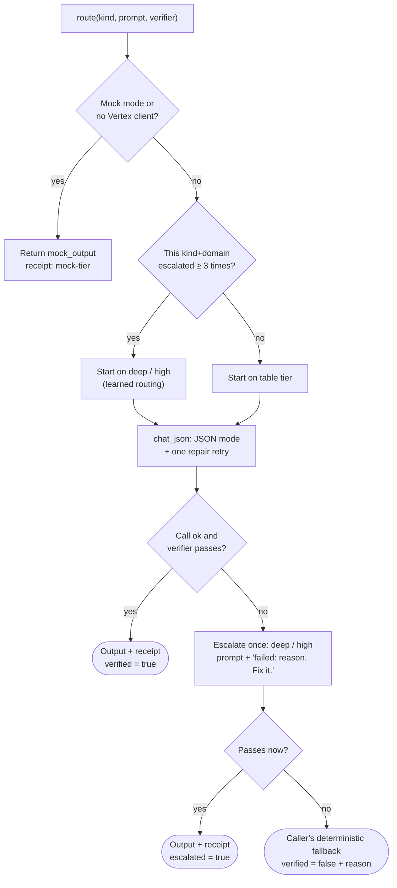

### 4.3 Transport resilience

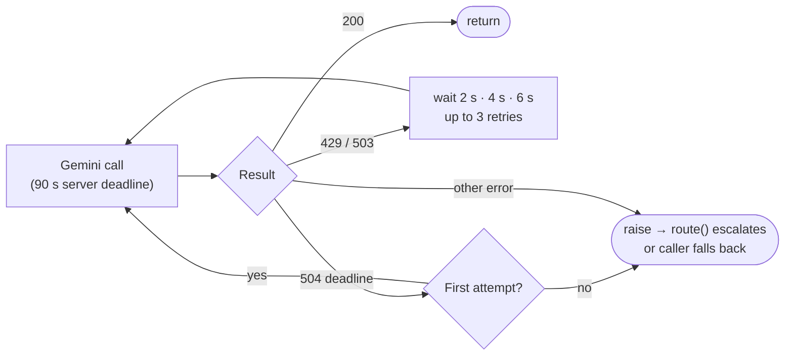

Streams retry only **before** the first chunk, so a retry never duplicates text the user
already saw.

### 4.4 JSON extraction

`extract_json` tries, in order: a whole-text parse, the last fenced ```` ```json ```` block,
and the last balanced `{…}` object. This lets prompts ask for a short explanation followed
by JSON (see §5.3) without breaking parsing.

---

## 5. Knowledge graph and source acquisition

### 5.1 Graph model

The per-user graph (`database/graph_store.GraphStore` + `features/knowledge.Knowledge`) has:

| Node kind | Fields | Embedded |
|---|---|---|
| `Source` | url, title (raw text stored separately in `sources/{id}`) | — |
| `Chunk` | text, ordinal | ✓ 768-d |
| `Concept` | label, domain | ✓ 768-d |
| `Generation` | gen_kind (anchors what an output was grounded in) | — |

| Edge | Meaning |
|---|---|
| `Source -HAS_CHUNK-> Chunk` | the page was cut into this passage |
| `Chunk -MENTIONS-> Concept` | the passage discusses the concept |
| `Concept -<REL>-> Concept` | extracted triple, e.g. `KAFKA -HAS_API-> PRODUCER_API` |
| `Generation -GROUNDED_IN-> Chunk` | an answer, reel or page cited this passage |

The in-memory dicts are a write-through cache over Firestore and are loaded lazily per user.

### 5.2 Ingestion

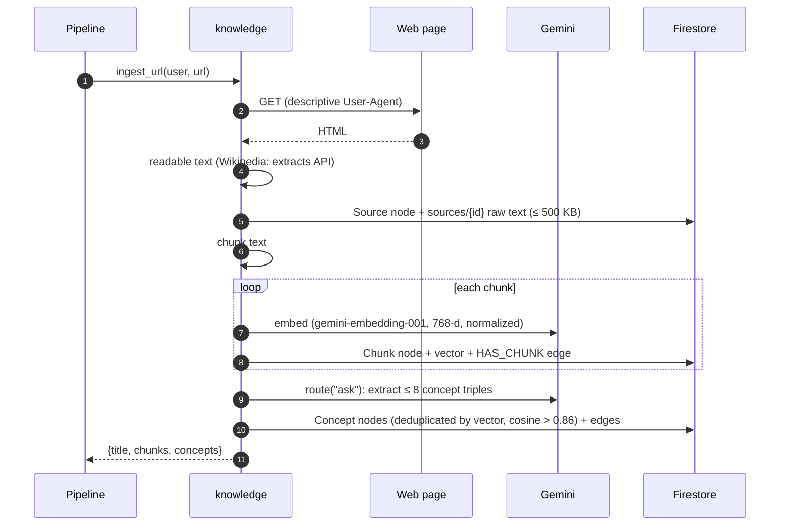

### 5.3 Finding sources (when the graph has nothing on a topic)

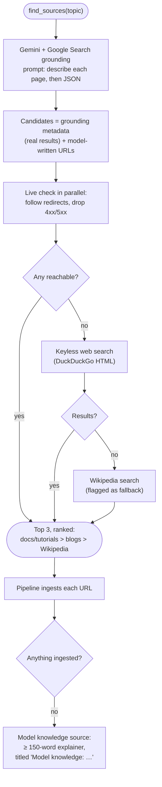

Two details matter here:

- **Why the "describe each page" step.** Vertex only attaches grounding metadata (the real
  result URLs) to text that makes claims. With a JSON-only reply it attaches none.
- **Why the live check.** URLs the model writes into its reply can be invented, and
  checking them stops the chat from showing *"Reading … 404"*.

### 5.4 Retrieval: `relevant_chunks`

- **Real embeddings:** vector KNN over chunks and concepts. A hit is kept if
  cosine ≥ `REEL_MIN_SIMILARITY` (0.6) **or** it contains at least half the topic's
  keywords. Concept hits pull in their mentioning chunks.
- **Hash mode** (mock, or an embedding-quota cooldown): keyword-overlap ranking over all chunks.
- **Embedding failure:** the system switches to hash mode for 10 minutes (a circuit
  breaker), so ingestion never goes dark.

---

## 6. 60-second visual reels

### 6.1 Pipeline

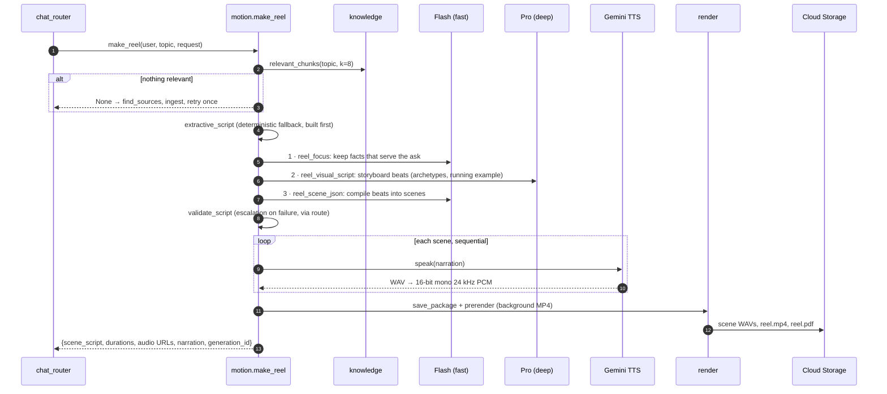

### 6.2 Validation rules (`motion.validate_script`)

- The script matches the `SceneScript` schema, and each scene's `slots` match its archetype model.
- Narration is at most **25 words** per scene.
- Every `grounded_in` is an **existing chunk ID** in the user's graph.
- Estimated runtime (words / 2.5 + a pad per scene) is at most **60 s**.

If the model fails twice, the **extractive fallback** ships instead, built from source
sentences. The receipt states why.

### 6.3 Scene archetypes

`title`, `build_diagram`, `compare_two`, `timeline`, `code_reveal`, `counter`, `callout`, `flow`,
`bar_chart`, `token_attention`, `matrix_heat`, `vector_space`, `cycle`, `keyword_match`.

The storyboard prompt pushes for variety: at least 4 different archetypes, no two
consecutive scenes alike, concrete labels, and one running example.

### 6.4 Narration fallback chain

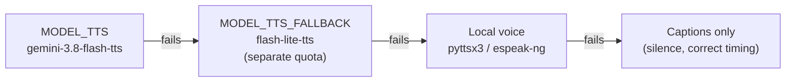

Scenes are voiced **sequentially**. A 429 waits 15 s once; a scene that still fails gets
silence of the right length, so one rate-limited scene doesn't mute the reel.

### 6.5 Rendering

`render` draws frames with Pillow (2× supersampled for the pictorial scenes) and encodes
H.264/AAC with the ffmpeg binary bundled in `imageio-ffmpeg`, so it needs no GPU and no
system install. `prerender` starts encoding in the background as soon as the reel exists,
so *Download MP4* is usually instant. In testing, MP4 took about 20 s and PDF slides about 2 s.

---

## 7. Managed study sessions

### 7.1 Planning

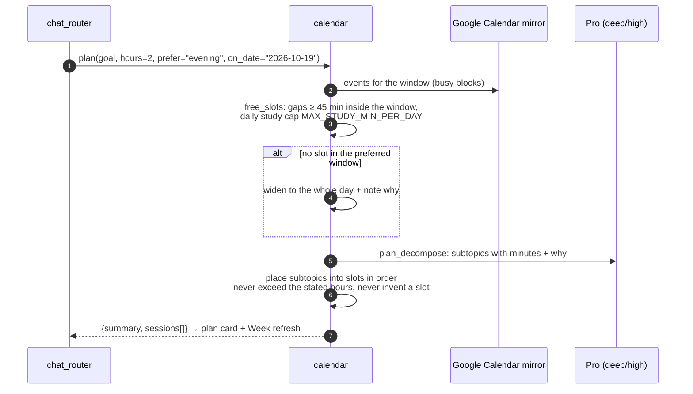

Time windows: morning 07:00–12:00, afternoon 12:00–17:00, evening 17:00–22:30.

### 7.2 Study book (multi-call) with critic

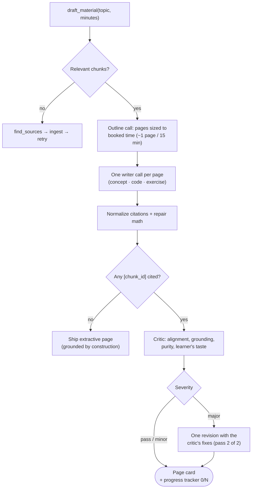

**Progress contract.** The Canvas reports the furthest page reached
(`POST /api/material/progress`). When a session is marked done with pages left, Recal
offers to book a follow-up session sized to the remaining pages.

---

## 8. Renegotiation and session edits

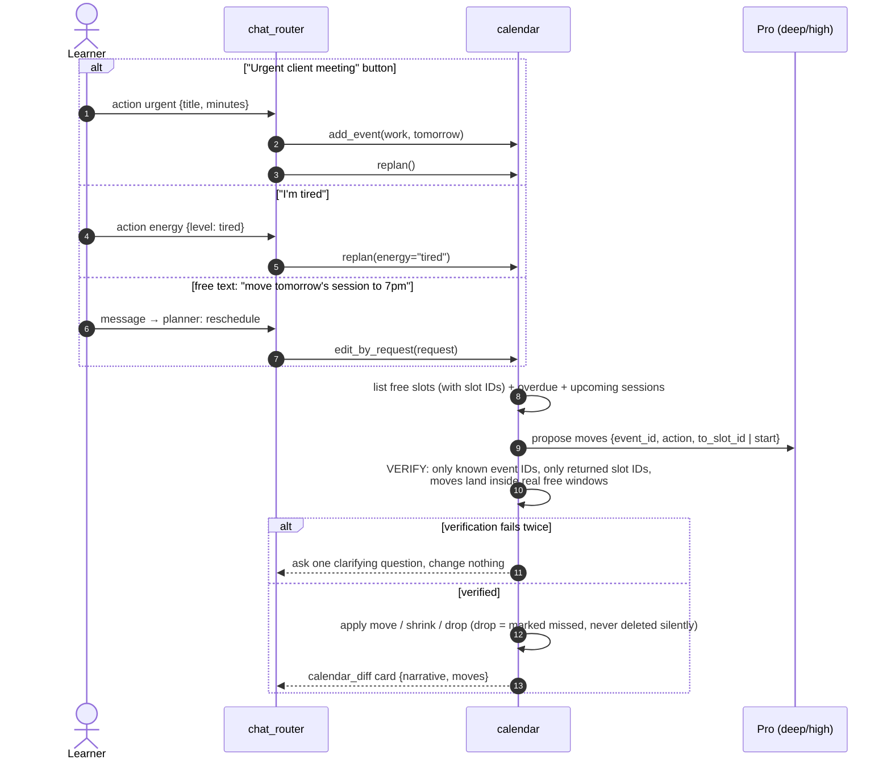

Google Calendar events are read-only mirrors: Recal only ever edits its own sessions.

---

## 9. AI client: document review, mock meeting, rehearsal

### 9.1 Upload and review

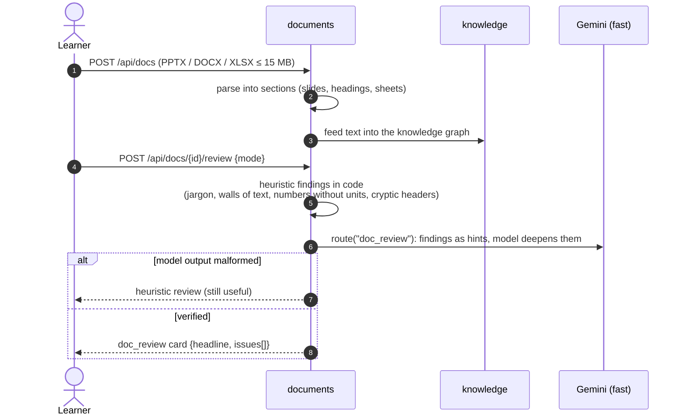

Modes: `message` (did the deck land its message?) and `client_ready` (can it go to a client?).

### 9.2 Mock client meeting

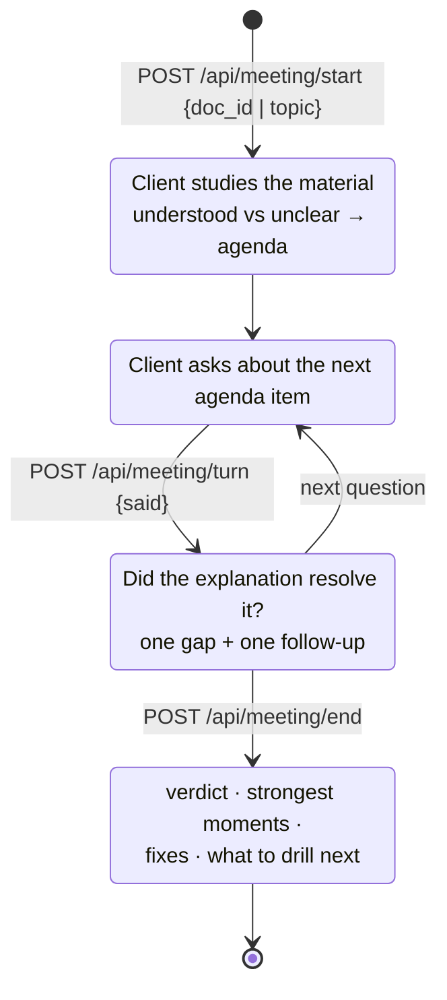

The browser handles the audio: SpeechRecognition for listening and speechSynthesis for the
client's voice, so a meeting costs zero model audio quota. Every turn goes through the input
guard. Without a model, a heuristic agenda (unexplained acronyms, numbers without
baselines) keeps the meeting running.

### 9.3 Rehearsal coach

`POST /api/docs/{id}/coach` (multipart: `section`, `audio`): the learner presents one slide
aloud. The audio is converted to 16 kHz WAV and sent with the slide text to Gemini, which
returns `{transcript, feedback, question}`: what landed, the gap versus the slide's claim,
and one client cross-question. Without a model, Recal asks a canned question built from the
slide itself.

---

## 10. Concierge agent (Google ADK)

Messages the planner can't map to a pipeline (small talk, open questions, session tweaks) go
to an ADK `LlmAgent` built by `agents/agent_factory.AgentFactory`:

| Tool | Does |
|---|---|
| `search_context(question)` | top-5 relevant chunks from the user's graph, wrapped as untrusted data |
| `read_week()` | this week's sessions and mirrored Google events |
| `edit_study_session(request)` | `calendar.edit_by_request` with the same verification gate as §8 |

Tools are **closures over the user ID**, so the model can't address another user's data. The
instruction (`concierge_instruction` in `prompts.yml`) plus a standing security rule forbids
following instructions found in tool results. If ADK is unavailable, the same prompt is
answered by the chat model directly.

---

## 11. Style memory

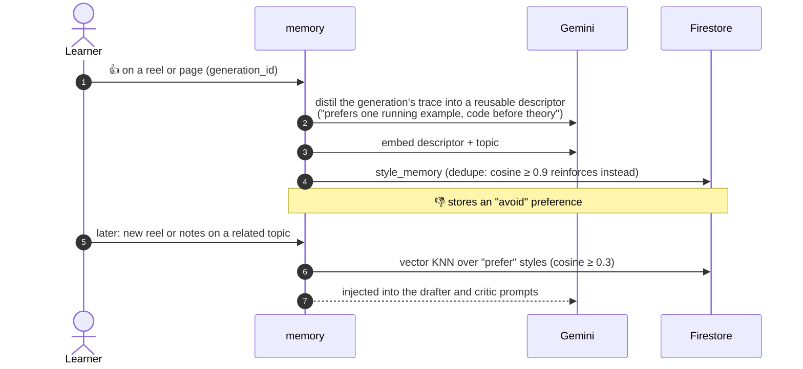

---

## 12. Google Calendar and Docs integration

### 12.1 OAuth (web server flow)

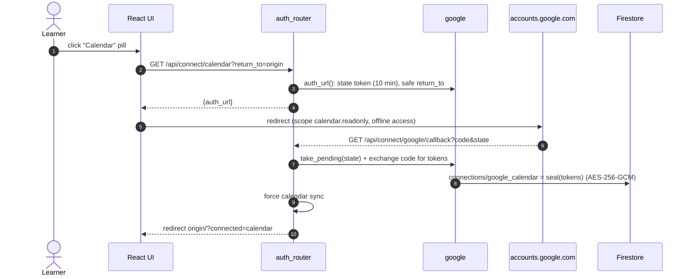

| Provider | Scope | Use |
|---|---|---|
| `calendar` | `calendar.readonly` | mirror the next 14 days of events (busy and free), synced at most every 60 s |
| `gdocs` | `drive.file` | create a new Doc from a card; Recal can only see files it created |

`return_to` is restricted to localhost or `OAUTH_REDIRECT_BASE`, so the callback can't be
used as an open redirect.

---

## 13. Guardrails and security

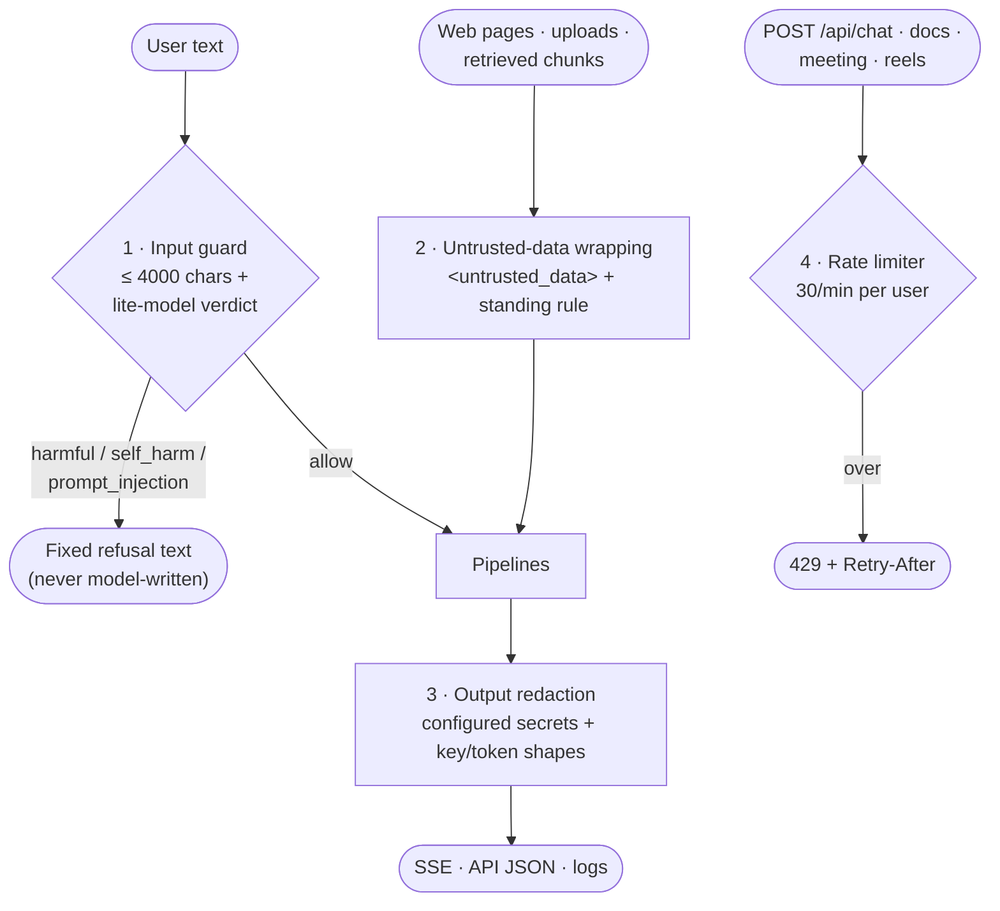

| Concern | Control |
|---|---|
| Credentials | none on the server: Vertex, Firestore, GCS and Secret Manager use the VM's service account (ADC) |
| Secrets at rest | OAuth tokens sealed with Cloud KMS or AES-256-GCM (`RECAL_ENCRYPTION_KEY`); weaker seals are upgraded on read |
| Database access | Firestore rules deny all client access; only the backend reads or writes |
| Prompt injection | outside text is tagged as untrusted, and agent tools are scoped to the calling user |
| Guard outage | fails **open** (logged), so a model outage never locks a learner out |
| Logs | redacted formatter; on the VM no logs are written to disk at all |

---

## 14. Data model

### 14.1 Firestore layout (schema v2, `database/schema.py`)

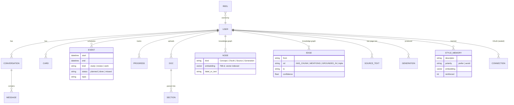

| Path | Contents |
|---|---|
| `users/{uid}/conversations/{conv}/messages/{id}` | chat messages + receipts |
| `users/{uid}/cards/{id}` | card records |
| `users/{uid}/events/{id}` | study, review and work events |
| `users/{uid}/progress/{topic}` | study-book progress `{done, total}` |
| `users/{uid}/docs/{id}/sections/{n}` | parsed uploads |
| `users/{uid}/nodes/{id}`, `edges/{id}` | knowledge graph (vector-indexed `embedding`) |
| `users/{uid}/sources/{node_id}` | raw page text (never bulk-loaded) |
| `users/{uid}/generations/{id}`, `style_memory/{id}` | pedagogy memory |
| `users/{uid}/connections/google_{provider}` | sealed OAuth tokens |
| `reels/{gen_id}` | reel package metadata (`user` = owner) |
| `config/app` | runtime key/value settings |

**Vector indexes** (cosine, flat, 768-d): `nodes (kind ASC, embedding)` and
`style_memory (polarity ASC, embedding)`.

### 14.2 Cloud Storage layout

`users/{uid}/reels/{gen_id}/scene{n}.wav · reel.mp4 · reel.pdf`. Downloads use V4 signed
URLs; when the credentials can't sign, the server proxies the bytes instead.

---

## 15. Resilience and graceful degradation

| Failure | What the learner gets |
|---|---|
| No Google Cloud configured | **mock mode**: every feature works with canned output |
| Model returns invalid JSON | one repair retry, then escalation to Pro, then the deterministic fallback |
| 429 / 503 from Vertex | automatic retry with backoff (2/4/6 s) |
| Call stalls | 90 s deadline → 504 → one retry → fallback |
| Google Search grounding finds nothing | web search → Wikipedia → model-knowledge source |
| Embedding quota exhausted | hash vectors + keyword retrieval for 10 min |
| TTS rate-limited | fallback TTS model → local voice → captions with correct timing |
| Reel script fails validation twice | extractive reel built from source sentences |
| Notes without citations | extractive grounded page |
| Planner model down | the whole message goes to the concierge agent |
| ADK unavailable | concierge prompt answered by the chat model directly |
| Guard model down | fails open (logged) |
| Firestore unreachable | in-memory working set for the session |

---

## 16. API reference

| Method | Path | Body / query | Returns |
|---|---|---|---|
| POST | `/api/chat` | `{message}` or `{action:{type,…}}` | SSE stream (§3.4) |
| GET | `/api/conversations` | — | `{conversations:[{id,title,ts}]}` |
| POST | `/api/conversations` | — | `{id}` new conversation |
| POST | `/api/auth` | `{guest:true}` or `{id_token}` | `{ok,user}` + `recal_user` cookie |
| GET | `/api/connect/calendar` | `?return_to=` | `{auth_url}` |
| POST | `/api/connect/notebook` | `{return_to}` | `{auth_url}` (Google Docs) |
| GET | `/api/connect/google/callback` | `code, state` | redirect back to the app |
| GET | `/api/connect/google` | — | connection status + sync result |
| DELETE | `/api/connect/calendar` · `/api/connect/gdocs` | — | disconnect (revoke + delete tokens) |
| GET | `/api/docs` | — | uploaded documents |
| POST | `/api/docs` | multipart `file` | `{doc:{id,name,kind,sections}}` |
| GET | `/api/docs/{id}` | — | parsed sections |
| POST | `/api/docs/{id}/review` | `{mode:"message"\|"client_ready"}` | `doc_review` card |
| POST | `/api/docs/{id}/coach` | multipart `section`, `audio?` | `{transcript,feedback,question}` |
| DELETE | `/api/docs/{id}/coach` | — | reset rehearsal |
| POST | `/api/meeting/start` | `{doc_id?, topic?}` | client's opening line |
| POST | `/api/meeting/turn` | `{said}` | `{say, gap}` |
| POST | `/api/meeting/end` | — | `{summary}` debrief |
| POST | `/api/reels/{gen_id}/render` | `{format:"mp4"\|"pdf"}` | `{url, seconds, bytes}` |
| GET | `/api/reels/{gen_id}/files/{name}` | `?inline=1` | WAV / MP4 / PDF |
| POST | `/api/feedback` | `{generation_id, signal:"up"\|"down", note?}` | `{style_descriptor}` |
| POST · GET | `/api/material/progress` | `{topic,page,total}` · `?topic=` | progress state |
| GET | `/api/settings/llm` | — | read-only model configuration |
| GET | `/api/health` | `?live=1` | config, problems, per-feature status, live pings |

The user is resolved from the `recal_user` cookie, and the conversation from `recal_conv`.

---

## 17. Configuration reference

| Variable | Default | Purpose |
|---|---|---|
| `GOOGLE_CLOUD_PROJECT` | — | enables Vertex AI + Firestore (unset = mock mode) |
| `GOOGLE_CLOUD_LOCATION` | `global` | Vertex location (Gemini 3.x Pro/TTS are global-only) |
| `GOOGLE_CLOUD_API_KEY` | — | optional Vertex API key (Gemini only; blank = service account) |
| `MOCK` | — | `1` forces canned output |
| `MODEL_LITE` / `MODEL_FAST` / `MODEL_DEEP` | 3.5-flash-lite / 3.8-flash / 3.1-pro-preview | model tiers |
| `MODEL_EMBED` | `gemini-embedding-001` | embeddings (768-d) |
| `MODEL_TTS` / `MODEL_TTS_FALLBACK` | 3.8-flash-tts / 3.8-flash-lite-tts | narration |
| `TTS_VOICE` | `Kore` | prebuilt Gemini voice |
| `TTS_STYLE` | `clear, friendly teaching voice` | delivery style, sent as speech metadata (never spoken) |
| `LOCAL_TTS` | `1` | offline voice fallback |
| `LLM_TIMEOUT_S` | `90` | per-call Gemini deadline |
| `REEL_MIN_SIMILARITY` | `0.6` | cosine floor for "on-topic" chunks |
| `MAX_STUDY_MIN_PER_DAY` | `150` | daily study cap used by the planner |
| `RECAL_MEDIA_BUCKET` | — | Cloud Storage bucket for media |
| `RECAL_ENCRYPTION_KEY` | — | 32-byte base64 key for AES-256-GCM token sealing |
| `RECAL_KMS_KEY` | — | Cloud KMS key (takes precedence over AES) |
| `GOOGLE_OAUTH_CLIENT_ID` / `_SECRET` | — | OAuth web client |
| `OAUTH_REDIRECT_BASE` | `http://localhost:8000` | public base URL for the OAuth callback |
| `SESSION_SECRET` | `change-me` | session secret |
| `GUARD_ENABLED` / `GUARD_MAX_CHARS` | `1` / `4000` | input guard |
| `RATE_LIMIT_PER_MIN` | `30` | per-user POST limit (`0` = off) |
| `LOG_LEVEL` / `LOG_TO_FILE` / `LOG_DIR` | `INFO` / `1` / `logs/` | logging (`LOG_TO_FILE=0` on the VM) |
| `PROMPTS_FROM_DB` | — | `1` = prompt overrides from Firestore `prompts/{name}` |
| `HTTP_USER_AGENT` | `RecalBot/0.2 (+repo URL)` | outbound fetches (Wikipedia policy) |
| `RENDER_SSAA` | `2` | supersampling for reel frames |

---

## 18. Frontend

React 19 + Vite, served by the backend from `frontend/dist`, from the same origin as `/api`.

| View | Shows |
|---|---|
| Chat (left) | the conversation, live status lines, receipts; quick actions (*Ingest a doc · Explain visually · Plan 4 hours · Urgent meeting · Write me notes · Ask a doubt · I'm tired*) |
| **Canvas** | reels (`ReelPlayer`, MP4/PDF downloads) and study books (`MaterialSlides`, page-by-page with progress) |
| **Week** | `WeekView`: Recal sessions + Google events, mark done or missed |
| **Cards** | every card: plans, diffs, sources, reviews; export to Google Docs |
| **Practice** | `PracticeView`: upload, review, rehearsal coach, `MeetingView` voice meeting |

Rendering helpers: `Markdown` (GFM + KaTeX math) and `Mermaid` (diagrams inside study pages).
`lib/stream.js` parses the SSE protocol.

---

## 19. Deployment architecture

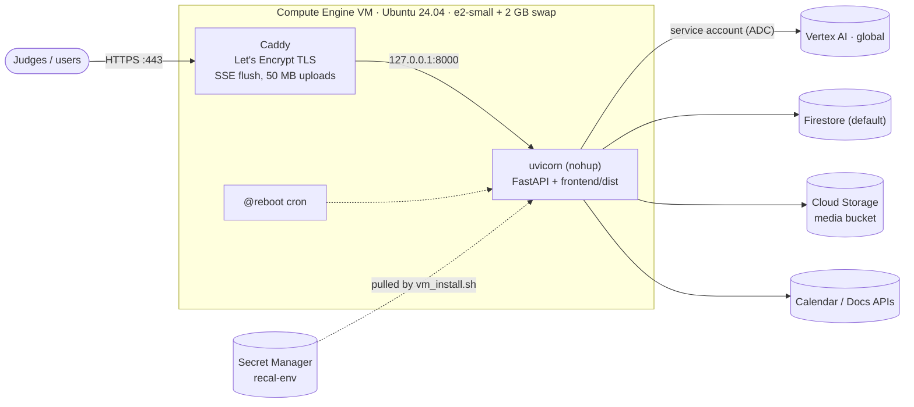

- `deploy/vm_install.sh` is idempotent. Each run:
  - adds swap and installs the packages;
  - pulls `.env` from Secret Manager;
  - builds the frontend, then deletes `node_modules` to save disk;
  - (re)starts the backend with `deploy/start.sh` and configures Caddy;
  - prints the URL.
- **No logs on disk:** app output goes to `/dev/null`, `LOG_TO_FILE=0`, and journald is
  RAM-only (16 MB cap).
- **Redeploy:** `git pull && bash deploy/vm_install.sh`. **Debug:** `bash deploy/start.sh fg`.

The full step-by-step guide is in [deploy/README.md](../deploy/README.md).

---

## 20. Testing and observability

- **`GET /api/health`** returns config, a problems list and a per-feature status (`real`, `mock`,
  `setup` or `broken`) with a note. **`?live=1`** makes one real call each to the lite, fast and
  deep models, embeddings, TTS and web search.
- **Receipts** on every output show the model, thinking level, `verified`, `escalated` and the
  reason, so they're visible in the UI log.
- **End-to-end API suite** (run against real Gemini; it uses its own test user and resets it):

| Check | Result |
|---|---|
| health, frontend, privacy page | ✅ |
| concierge chat | ✅ |
| plan study time | ✅ |
| reel (6 scenes, Gemini TTS, real web sources) | ✅ |
| reel → PDF / MP4 | ✅ ~2 s / ~20 s |
| grounded Q&A | ✅ ~7 s |
| study notes (multi-page + critic) | ✅ |
| doc upload + review | ✅ |
| mock meeting start / turn / end | ✅ |
| reset | ✅ |

**16/16 passed.**

---

## 21. Limitations and roadmap

| Limitation | Next step |
|---|---|
| Guests share one `demo` profile | issue a per-browser `g_<uuid>`; verify Google ID tokens (or Firebase Auth) for sign-in |
| Single process holds OAuth state + graph cache | move OAuth state to Firestore; run on Cloud Run with min instances |
| OAuth app unverified (100-user cap, warning screen) | domain verification + Google OAuth review |
| Reels are 2–3 min end to end on a cold topic | cache sources per topic; stream scenes as they're narrated |
| Calendar is read-only | optional write-back of study sessions to Google Calendar |
