# How Recal Works

> This guide walks through Recal from the learner's point of view, then shows the parts
> underneath. Every section starts with *what you see*, then *what Recal does behind the
> scenes*, with a diagram. Developers will find the file names in the **Under the hood**
> notes and the full reference tables at the end.
>
> For a quick overview see the [README](../README.md). To run it on Google Cloud, see the
> [deployment guide](../deploy/README.md).

## Contents

1. [Recal in one minute](#1-recal-in-one-minute)
2. [Words used in this guide](#2-words-used-in-this-guide)
3. [The big picture](#3-the-big-picture)
4. [What happens when you send a message](#4-what-happens-when-you-send-a-message)
5. [How Recal picks a model and checks its work](#5-how-recal-picks-a-model-and-checks-its-work)
6. [Your knowledge library](#6-your-knowledge-library)
7. [Making a 60-second video explainer](#7-making-a-60-second-video-explainer)
8. [Planning study time and writing study books](#8-planning-study-time-and-writing-study-books)
9. [When your week changes](#9-when-your-week-changes)
10. [Practising with an AI client](#10-practising-with-an-ai-client)
11. [The chat assistant](#11-the-chat-assistant)
12. [Learning your teaching style](#12-learning-your-teaching-style)
13. [Connecting Google Calendar and Docs](#13-connecting-google-calendar-and-docs)
14. [Keeping you safe](#14-keeping-you-safe)
15. [Where your data lives](#15-where-your-data-lives)
16. [When something goes wrong: Plan B](#16-when-something-goes-wrong-plan-b)
17. [Running on Google Cloud](#17-running-on-google-cloud)
18. [How we test it](#18-how-we-test-it)
19. [What's next](#19-whats-next)
20. [Reference: API](#20-reference-api)
21. [Reference: settings](#21-reference-settings)
22. [Reference: code map](#22-reference-code-map)

---

## 1. Recal in one minute

Imagine you have a client demo on Friday and you need to understand Kafka before then.
You type one sentence into Recal:

> *"Plan 2 hours tomorrow evening for Kafka and prepare notes."*

Here's what happens next:

1. Recal **reads your calendar** and finds a free evening slot.
2. It **books two study sessions** that fit your 2 hours exactly.
3. It **searches the web** for good Kafka pages, reads them and saves the key passages.
4. It **writes a study book** from those pages, with a citation on every claim, and a second
   AI "critic" reviews the book before you see it.

Later you ask *"Show me Kafka partitions as a 1-minute visual"* and get a narrated, animated
video built from the same sources. On Thursday, an urgent meeting lands on your calendar.
You press **Urgent meeting** and Recal moves your study sessions out of the way.

Before the demo, you upload your slides. Recal plays the client and asks you the hard
questions, then tells you which answers didn't land.

**What makes it different:** Recal doesn't just answer questions. It plans, it adapts when
your week falls apart, and it checks every AI output before you see it.

---

## 2. Words used in this guide

| Word | What it means here |
|---|---|
| **Gemini** | Google's AI models. Recal uses several sizes of them through Google Cloud. |
| **Model tier** | Which size of Gemini does a job: **Lite** (instant decisions), **Fast** (everyday work) or **Pro** (hard thinking). |
| **Source** | A web page or document Recal has read for you. |
| **Passage** | A short piece of a source, a few sentences long. Recal cites passages, not whole pages. |
| **Knowledge library** | Everything Recal has read for you, organised as sources → passages → ideas. (Technically a *knowledge graph*.) |
| **Citation** | A small number linking a claim to the passage it came from. |
| **Card** | A result shown in the app: a plan, a video, a study book, a review. |
| **Receipt** | A label on every card saying which model made it and whether it passed Recal's checks. |
| **Check** | Code that verifies an AI output, for example "does every scene cite a real passage?" |
| **Retry with Pro** | When a check fails, Recal asks the stronger Pro model once more, telling it what was wrong. |
| **Plan B** | The safe fallback Recal uses when the AI fails, so you always get a result. |
| **Mock mode** | A demo mode with no AI calls, used when Google Cloud isn't configured. |

---

## 3. The big picture

Recal is one web app, a **React website** talking to a **Python server** (FastAPI). The
server uses Google Cloud for everything AI and storage related.

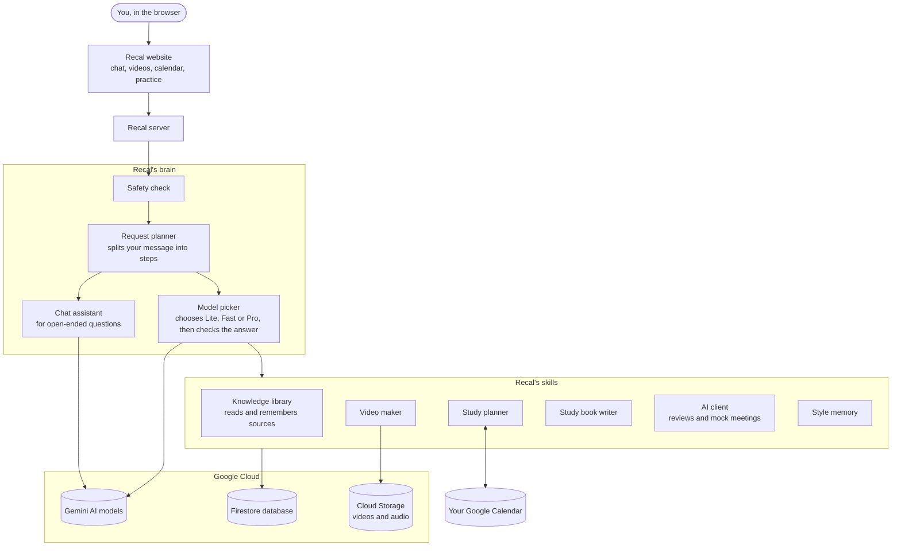

**Who does what**

| Part | Its job | Under the hood |
|---|---|---|
| Recal website | Chat, video player, week view, practice room | `frontend/src/` |
| Safety check | Blocks harmful requests and attempts to trick Recal | `helper/guardrails.py` |
| Request planner | Turns your sentence into a list of steps | `features/intents.py` |
| Model picker | Chooses the right Gemini model, checks the answer, retries with Pro | `features/llm.py` |
| Chat assistant | Handles small talk and open questions using tools | `agents/` |
| Knowledge library | Finds, reads and remembers sources | `features/knowledge.py`, `database/` |
| Video maker | Writes, narrates and renders 60-second videos | `features/motion.py`, `render.py` |
| Study planner | Finds free time and books sessions | `features/calendar.py` |
| Study book writer | Writes multi-page notes and has them reviewed | `features/material.py` |
| AI client | Reviews decks and runs mock meetings | `features/documents.py`, `meeting.py`, `rehearse.py` |
| Style memory | Remembers how you like to be taught | `features/memory.py` |

Two rules keep the code tidy:
- Only the **model picker** talks to Gemini.
- Only the **database** layer talks to Firestore and Cloud Storage.

Every AI instruction lives in one file, `helper/prompts.yml`, so prompts can be reviewed in
one place.

---

## 4. What happens when you send a message

Everything starts in the chat box. There is just one entrance, and Recal works out what you want.

**The story:**

1. You send a message.
2. Two things happen **at the same time**: the safety check reads it, and the request
   planner splits it into steps. Running them together means safety adds no waiting time.
3. Each step runs its skill, such as booking time, making a video or writing notes.
4. Results stream back **live**: you see progress lines ("Reading kafka.apache.org…"), then
   the text, then the cards.
5. Everything is saved, so the chat is still there after a refresh.

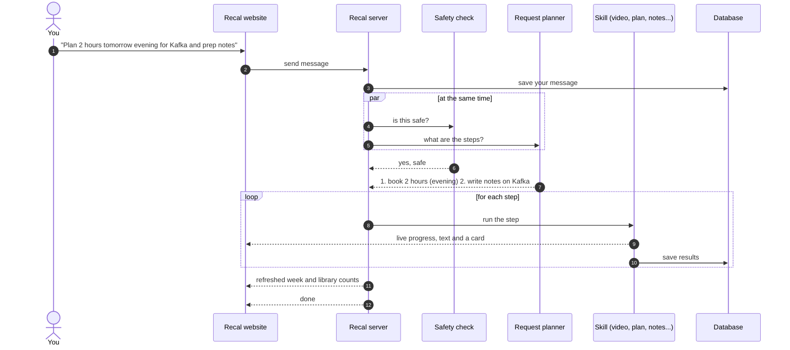

If the safety check says no, nothing runs: you get a fixed, polite refusal instead.

### The seven kinds of request

The request planner sorts every step into one of these:

| You say something like… | Step | What you get |
|---|---|---|
| "Plan 4 hours this week for LangGraph" | **plan** | sessions booked into free slots + a plan card |
| "Move tomorrow's session to 7pm" | **reschedule** | sessions moved + a changes card |
| "Show BM25 vs embeddings as a 1 min visual" | **video** | a narrated video (+ source cards if it had to search) |
| "Write me notes on hybrid retrieval" | **notes** | a multi-page study book |
| "How does hybrid retrieval work?" | **answer** | an answer citing your sources (or a live Google search) |
| a link: `https://…` | **read** | the page is read into your library |
| anything else ("hi, what can you do?") | **chat** | an answer from the chat assistant |

A single message can contain several steps. *"Plan 2 hours tomorrow evening and prep notes"*
becomes **plan → notes**, and the study book is sized to the booked time (about one page per
15 minutes).

### The quick-action buttons

Some buttons skip the planner because the action is already clear:

| Button | What happens |
|---|---|
| **Urgent meeting** | adds a work block tomorrow and re-plans your week around it |
| **I'm tired** | lightens the week by moving or shrinking sessions |
| **Mark done / missed** | updates a session; if a study book still has unread pages, offers a follow-up session |
| **Export → Docs** | turns a card into a new Google Doc |
| **Reset** | clears your chat, cards and Recal's sessions |

### What "live updates" look like

The server streams small messages while it works. The website listens for six kinds:

| Message | Shown as |
|---|---|
| progress | grey lines such as "Reading https://…" |
| text | the reply appearing word by word |
| card | a result card (video, plan, notes…) |
| receipt | "gemini-3.8-flash · verified ✓" under a card |
| state | your week and library refresh |
| done / error | the turn is finished (errors still end cleanly) |

> **Under the hood:** `POST /api/chat` returns a Server-Sent Events stream
> (`router/chat_router.py`). Every message passes through secret redaction before it leaves
> the server.

---

## 5. How Recal picks a model and checks its work

Not every job needs the biggest model. Recal uses three sizes of Gemini, like a team with a
receptionist, a generalist and a senior expert:

| Tier | Model | Good at | Used for |
|---|---|---|---|
| **Lite** | `gemini-3.5-flash-lite`, temperature 0 | instant, consistent decisions | the safety check, splitting your message into steps, tagging styles |
| **Fast** | `gemini-3.8-flash` | quick, solid everyday work | chat, video scripts, study pages, deck reviews |
| **Pro** | `gemini-3.1-pro-preview` | careful reasoning | planning your schedule, directing the video's visuals, second attempts |

The Lite tier runs at **temperature 0**, which means *no randomness*: the same message is
always understood the same way.

### Check every answer, retry once with Pro

The model picker doesn't trust an AI answer just because it arrived. It checks it in code,
and if the check fails it gives Pro one more try, explaining what was wrong. If that also
fails, it uses Plan B. You always get *something*, and the receipt tells you which path was taken.

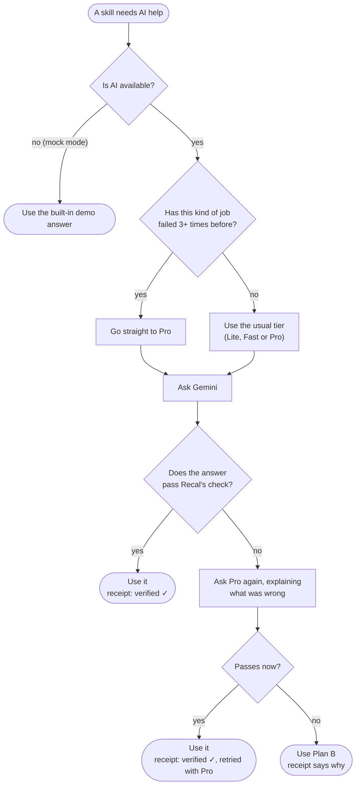

Recal also **learns from failures**. If a kind of job keeps failing on a topic, it starts
with Pro next time.

### When Google is busy

Sometimes Google's servers are overloaded. Recal handles that politely instead of failing:

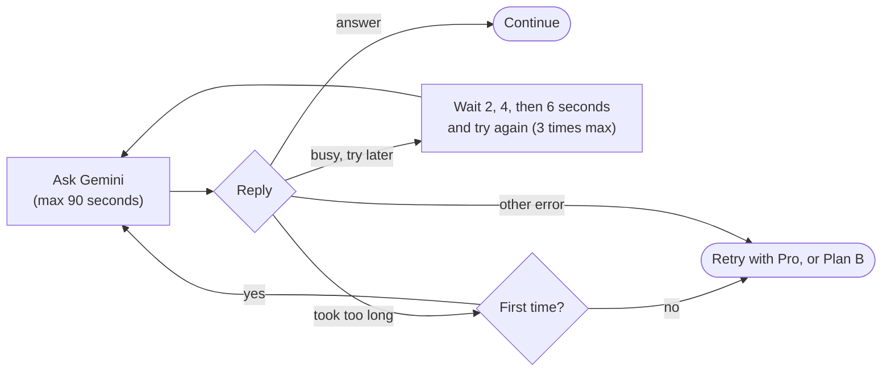

> **Under the hood:** `llm.route()` does tier selection, the check, the Pro retry and Plan B.
> `with_retry()` handles HTTP 429/503 (busy) and 504 (deadline). Streaming text is only retried
> before the first word appears, so you never see a sentence twice.

---

## 6. Your knowledge library

Recal doesn't answer from vague memory. It answers from **sources it has read for you**, and
the knowledge library is where those sources live.

### How the library is organised

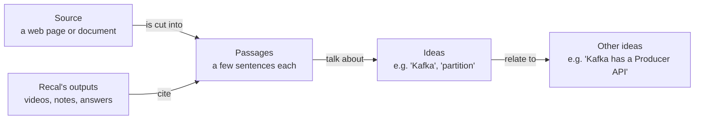

Each passage and idea also gets an **embedding**, a list of numbers that captures its meaning.
That's how Recal finds passages *about* "auto" when you searched for "car".

### How a web page becomes knowledge

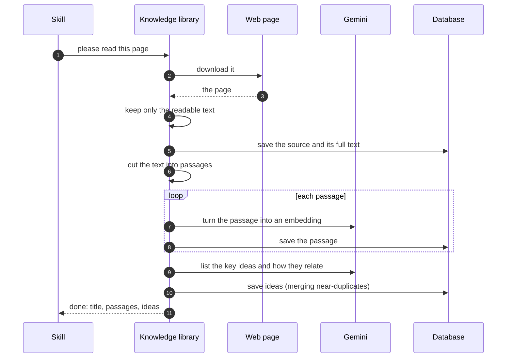

### Finding good sources when the library is empty

When you ask about something Recal hasn't read yet, it goes looking. It tries the best option
first and steps down only when it has to:

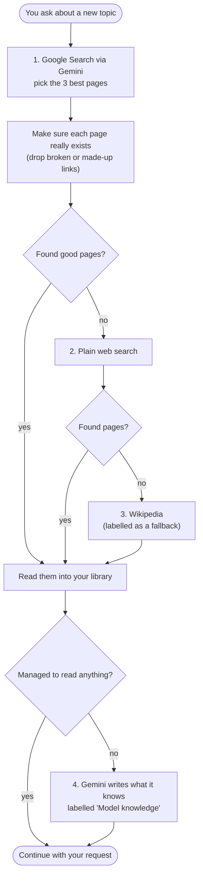

There are two details here:

- **Why "make sure each page exists":** AI models sometimes invent plausible-looking links.
  Recal checks every link before reading it, so you never see "Reading … 404".
- **Labels:** Recal ranks official docs and tutorials above blogs, and Wikipedia last. A
  "Model knowledge" source is always labelled as such, so you know where a claim came from.

### Finding the right passages

When a skill needs material on a topic, the library returns passages that are **close in
meaning** (similarity of at least 0.6) **or** contain at least half of the topic's keywords.
If embeddings are temporarily unavailable, it falls back to keyword matching for 10 minutes
rather than stopping.

---

## 7. Making a 60-second video explainer

**What you see:** you type *"Show BM25 vs embeddings as a 1 min visual"*, watch a few
progress lines, and a narrated, animated video appears on the Canvas with 6 or 7 scenes, each
citing a source. You can download it as an MP4 or as PDF slides.

**What happens behind the scenes:** three AI passes, then quality checks, narration and rendering.

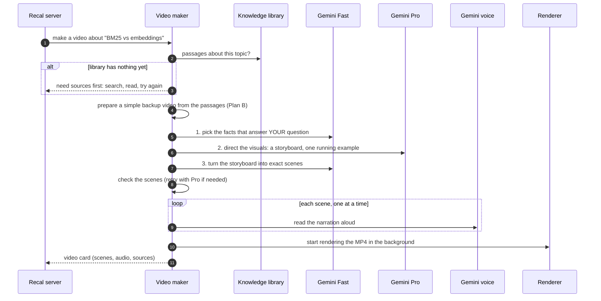

### Quality checks every video must pass

- Every scene **cites a real passage** from your library.
- Each scene's narration is **25 words or fewer**.
- The whole video runs **60 seconds or less**.
- Each scene's layout has the fields it needs, for example a chart has its bars.

If the AI fails these twice, Recal ships the **backup video** built directly from source
sentences, and the receipt says so.

### Scene types

The storyboard picks from 14 visual layouts and aims for variety (at least 4 different types,
never the same type twice in a row):

| Layout | Good for | Layout | Good for |
|---|---|---|---|
| title | the opening hook | flow | a process or protocol, step by step |
| build_diagram | a system being assembled | cycle | loops and feedback |
| compare_two | X vs Y side by side | timeline | how something changes over time |
| keyword_match | exact-word search, highlighted | counter | a number that grows |
| bar_chart | comparing quantities | code_reveal | code appearing line by line |
| vector_space | meaning as points in space | token_attention | how an AI model focuses on words |
| matrix_heat | grids of scores | callout | one key takeaway |

### The narrator's Plan B

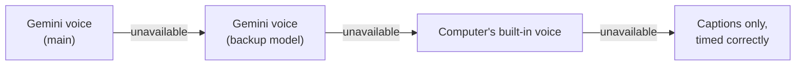

The narrator speaks only the scene text. The delivery style ("clear, friendly teaching voice")
is sent separately, so it's never read aloud. Scenes are voiced one at a time, so a busy moment
silences at most one scene, never the whole video.

### Turning scenes into a video

The renderer draws every frame in Python (Pillow) and encodes the MP4 with ffmpeg. It needs no
GPU and no paid service. Rendering starts as soon as the video is made, so the download button
is usually instant. In testing, an MP4 took about 20 seconds and PDF slides about 2 seconds.

> **Under the hood:** `features/motion.py` (pipeline), `features/reel_engine.py` +
> `features/render.py` (drawing and encoding), `schemas/reel.py` (scene layouts).

---

## 8. Planning study time and writing study books

### Booking study time

**What you see:** *"Plan 2 hours tomorrow evening for Kafka"* → a plan card and new blocks in
your Week tab.

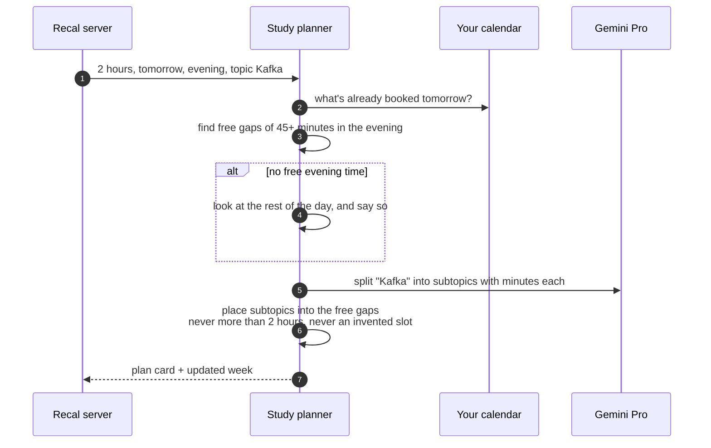

The planner keeps a few promises:
- It never books more time than you asked for.
- It only uses gaps that really exist on your calendar.
- It respects a daily study limit (150 minutes by default).
- It tells you when it couldn't honour your time of day.

Times of day: **morning** 7:00–12:00, **afternoon** 12:00–17:00, **evening** 17:00–22:30.

### Writing a study book

**What you see:** a book of several pages on the Canvas, with explanations, diagrams, tables,
code and a final practice page. Every claim has a small citation number.

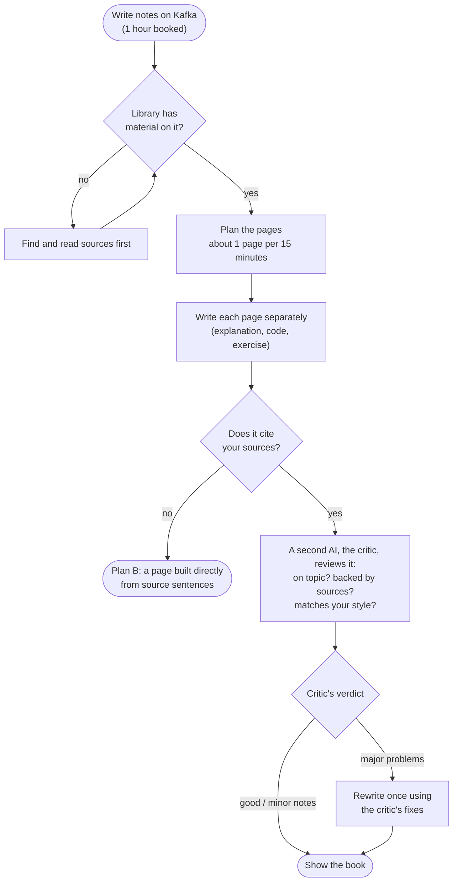

### Tracking your progress

As you swipe through the book, Recal remembers the furthest page you reached. When you mark
the session done and pages are left, it offers to book a follow-up session sized to the rest.

> **Under the hood:** `features/calendar.py` (`free_slots`, `plan`), `features/material.py`
> (`draft_material`, `review_and_revise`), progress via `POST /api/material/progress`.

---

## 9. When your week changes

Plans break. Recal's job is to re-plan without losing anything.

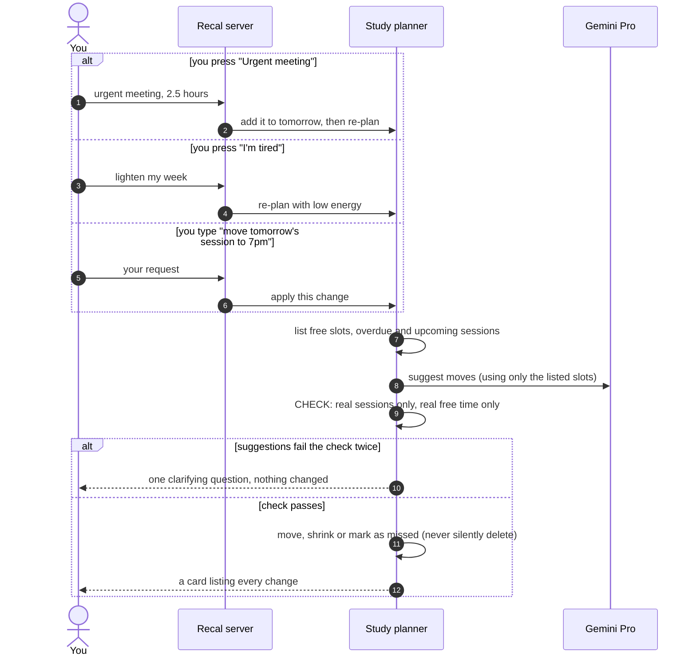

Recal only ever changes **its own** study sessions. Your Google Calendar events are read-only.

---

## 10. Practising with an AI client

Upload a presentation (PPTX), document (DOCX) or spreadsheet (XLSX) in the **Practice** tab.
Recal can then do three things with it.

### 1. Review it

**What you see:** a review card that answers either *"Does this deck land its message?"* or
*"Is it ready for a client?"*, with issues sorted by how urgent they are.

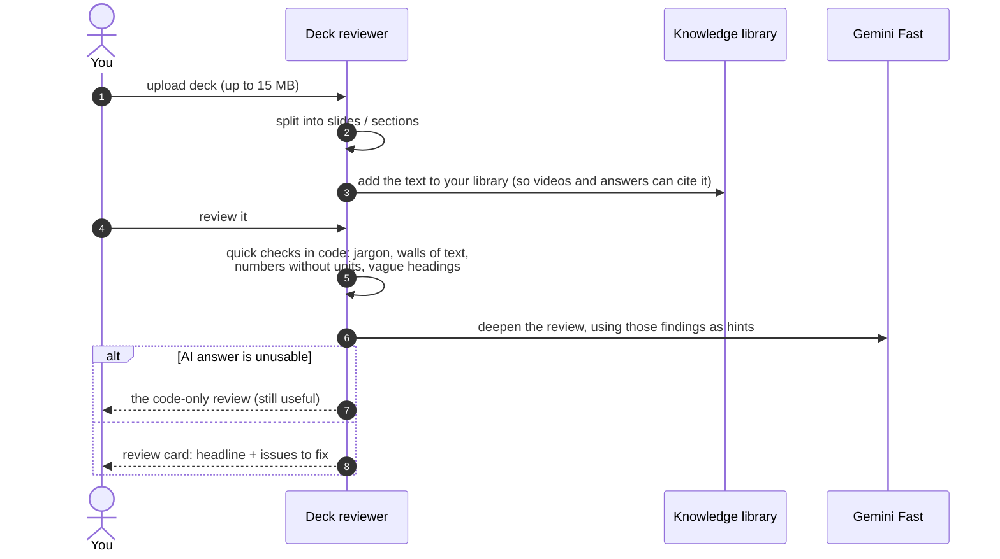

### 2. A mock client meeting

**What you see:** a voice conversation. The client asks about the weak spots in your material,
you answer out loud, and at the end you get an honest debrief.

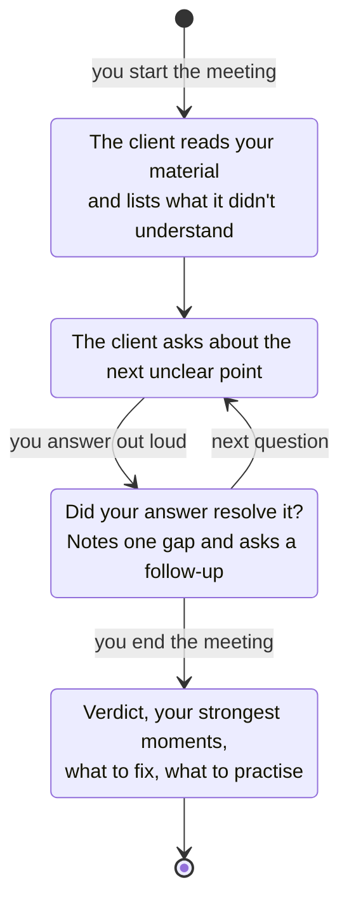

Your browser does the listening and speaking (speech recognition and speech synthesis), so a
meeting doesn't use any AI audio quota. If the AI is unavailable, the client still asks sensible
questions, for example about unexplained acronyms or numbers with no baseline.

### 3. Rehearse slide by slide

Present one slide out loud and Recal listens. Gemini hears your recording together with the
slide's text, then gives you short feedback (what landed, what the slide claims that you didn't
back up) and one question a real client might ask next.

> **Under the hood:** `features/documents.py`, `features/meeting.py`, `features/rehearse.py`;
> endpoints under `/api/docs` and `/api/meeting`.

---

## 11. The chat assistant

Some messages don't fit a skill: *"hi, what can you do?"*, *"what's on my calendar?"*,
*"shrink Friday's session"*. These go to the **chat assistant**, an AI agent built with
**Google's Agent Development Kit (ADK)** that can use three tools:

| Tool | What it does |
|---|---|
| search my sources | finds the 5 most relevant passages in your library |
| read my week | lists this week's sessions and Google events |
| edit a session | moves, shrinks or deletes one of your sessions, with the same safety checks as §9 |

The tools can only see **your** data; they're locked to your account before the agent starts.
The agent is told never to follow instructions found inside web pages or documents. If the
agent framework is unavailable, the same instructions go straight to Gemini Fast.

> **Under the hood:** `agents/agent_factory.py` builds the agent, and `agents/workflow.py` runs
> it with its tools.

---

## 12. Learning your teaching style

**What you see:** under every video and study book there are two buttons, **👍 This clicked**
and **👎 Not for me**. After you click, the button is replaced by what Recal learned, for example:

> 👍 Learned: *Introduce the concept with an everyday analogy, summarise the effect in a
> comparison table, give a runnable command, and end with a practice exercise.*

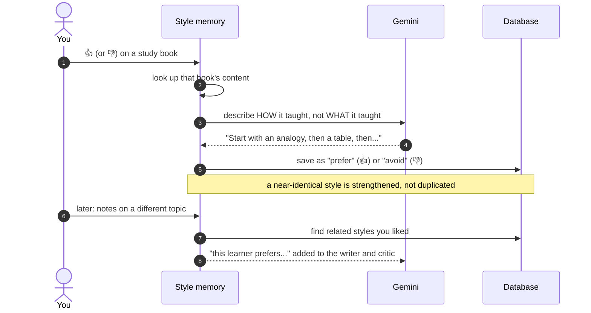

Styles are **topic-free**: a style learned from a Kafka book also shapes your next book on
Python.

---

## 13. Connecting Google Calendar and Docs

Click the **Calendar** or **Google Docs** pill at the top of the app. Google asks you to choose
an account and approve access, and you're sent back to Recal, now connected.

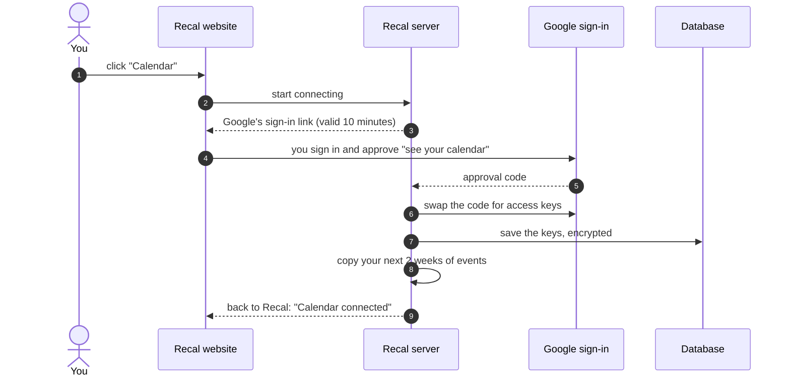

| Connection | Permission asked | What Recal does with it |
|---|---|---|
| Calendar | read your calendar | shows your events in the Week tab and plans around busy times (refreshed at most once a minute) |
| Google Docs | create files | creates a new Doc when you export a card; it can only see files it created itself |

Your access keys are **encrypted** before they're stored. Disconnecting deletes them and also
revokes Recal's access on Google's side.

> **Note:** Recal's Google app isn't yet verified by Google, so you'll see *"Google hasn't
> verified this app"*. Click **Advanced → Go to Recal** to continue.

---

## 14. Keeping you safe

Recal has four layers of protection:

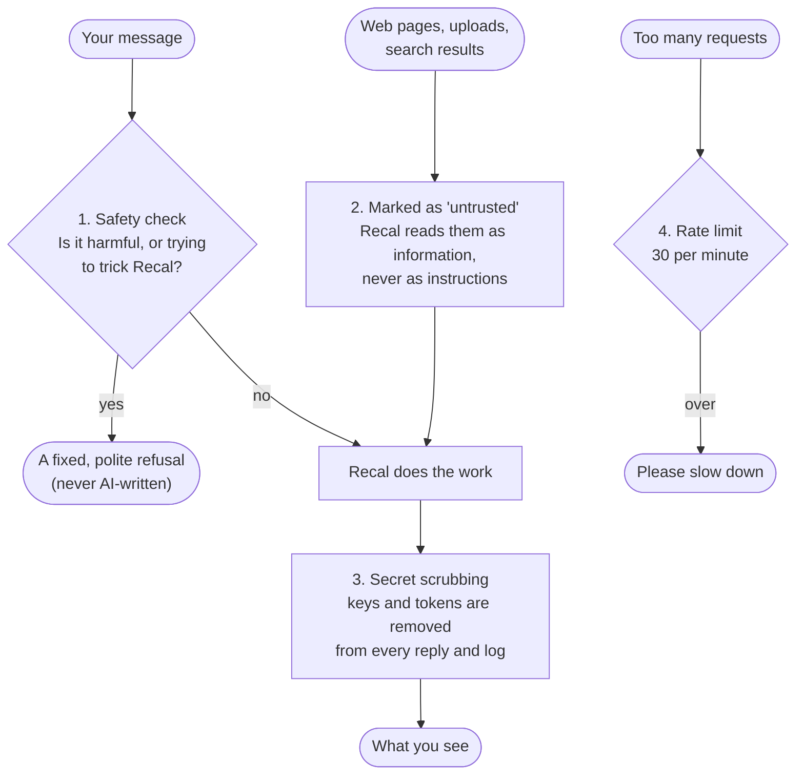

What each layer guards against:

| Risk | How Recal handles it |
|---|---|
| Harmful requests | blocked by the Lite-model safety check; self-harm gets a supportive message |
| A web page saying "ignore your instructions…" | outside text is wrapped and labelled as data only |
| Leaking keys | none are stored in the app: it signs in to Google Cloud as its own service account |
| Stolen database | Google sign-in keys are encrypted (AES-256-GCM); browsers can't access the database at all |
| Safety-check outage | Recal lets messages through (and logs it) rather than locking everyone out |
| Server logs | secrets are scrubbed, and the live server writes no logs to disk |

> **Under the hood:** `helper/guardrails.py` (all four layers), `database/fire.py` (encryption).

---

## 15. Where your data lives

Everything is stored per user in **Firestore** (Google's cloud database). Videos and audio go to
**Cloud Storage**.

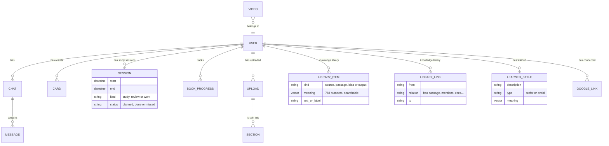

| What | Where in Firestore |
|---|---|
| chats and messages | `users/{you}/conversations/{chat}/messages` |
| result cards | `users/{you}/cards` |
| study sessions and work blocks | `users/{you}/events` |
| study book progress | `users/{you}/progress` |
| uploaded documents | `users/{you}/docs/{doc}/sections` |
| knowledge library | `users/{you}/nodes` (sources, passages, ideas) and `users/{you}/edges` (links) |
| full text of each source | `users/{you}/sources` |
| learned styles | `users/{you}/style_memory`, plus `users/{you}/generations` |
| Google connections (encrypted) | `users/{you}/connections` |
| videos | `reels/{video}` (owner recorded on each) |

Two **search indexes** let Recal find things by meaning: one over library passages and ideas,
and one over learned styles. In Cloud Storage, each video's files (`scene0.wav`…, `reel.mp4`,
`reel.pdf`) live under `users/{you}/reels/{video}/`. Downloads use short-lived private links.

---

## 16. When something goes wrong: Plan B

Recal is built so that a failure makes the result a bit simpler, never a crash. This table is
the full list:

| If this fails… | …you still get |
|---|---|
| Google Cloud isn't set up | **mock mode**: every feature works with demo content |
| the AI gives a malformed answer | one fix-up attempt, then a retry with Pro, then Plan B |
| Google is busy (overloaded) | automatic waiting and retrying (2, 4, 6 seconds) |
| a request hangs | it's stopped after 90 seconds and tried once more |
| Google Search finds nothing | web search → Wikipedia → Gemini's own knowledge (labelled) |
| embeddings are unavailable | keyword search for 10 minutes |
| the voice is unavailable | backup voice → built-in voice → captions |
| a video script fails its checks twice | a simple video built from source sentences |
| study notes come back without citations | a page built directly from your sources |
| the request planner is down | your message goes to the chat assistant |
| the agent framework is down | Gemini answers directly |
| the safety check is down | messages are allowed through (and logged) |
| the database is unreachable | your session continues in memory |

---

## 17. Running on Google Cloud

The live demo runs on **one small Google Cloud server**:

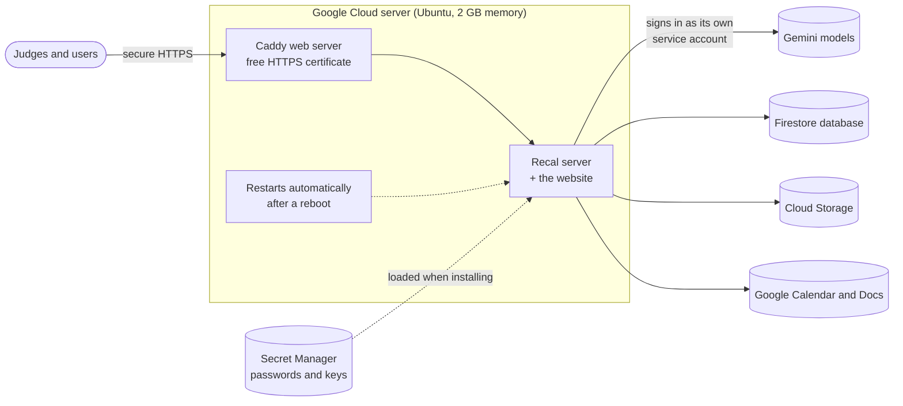

- **One command installs or updates everything:** `bash deploy/vm_install.sh`. It:
  1. sets up the server and adds swap memory;
  2. loads the settings from Secret Manager;
  3. builds the website;
  4. starts Recal in the background;
  5. turns on HTTPS;
  6. prints the public link.
- **To update after a code change:** `git pull && bash deploy/vm_install.sh`.
- **To watch what's happening:** `bash deploy/start.sh fg` shows live logs on screen.
  Nothing is saved to disk.

The step-by-step setup (Google Cloud project, permissions, database, sign-in) is in the
[deployment guide](../deploy/README.md).

---

## 18. How we test it

**Health check.** Open `/api/health` to see which features are ready. Add `?live=1` and Recal
makes one tiny real call to each model (Lite, Fast, Pro), to embeddings, to the voice and to
web search, then reports what works.

**Receipts.** Every result shows which model made it and whether it passed its checks, so
problems are visible in the app itself.

**End-to-end test.** A script sends real requests through the API as a separate test user, then
cleans up after itself. On the last full run, against real Gemini, it passed **16 of 16**:

| Test | Result | Typical time |
|---|---|---|
| health, website, privacy page | ✅ | instant |
| chat assistant | ✅ | ~15 s |
| plan study time | ✅ | ~8 s for the booking |
| make a video (with real web sources and Gemini voice) | ✅ | 2–3 min |
| download video as PDF / MP4 | ✅ | ~2 s / ~20 s |
| answer a question from the library | ✅ | ~7 s |
| write a study book (with critic) | ✅ | ~3 min |
| upload + review a deck | ✅ | ~10 s |
| mock meeting: start, answer, debrief | ✅ | seconds each |

---

## 19. What's next

| Today | Next step |
|---|---|
| Guest visitors share one demo profile | give every browser its own private guest profile, and support real Google sign-in |
| Recal runs as one server process | move sign-in state into the database and run on Cloud Run for scale |
| Google shows an "unverified app" warning | complete Google's app verification |
| A video on a brand-new topic takes 2–3 minutes | reuse sources across users, and play scenes while the rest are still being made |
| Calendar is read-only | optionally add study sessions to your Google Calendar |

---

## 20. Reference: API

All endpoints are under `/api`. Your identity comes from the `recal_user` cookie, and the
current chat from `recal_conv`.

| Method | Path | Send | Get back |
|---|---|---|---|
| POST | `/api/chat` | `{message}` or `{action:{type,…}}` | live updates stream (§4) |
| GET / POST | `/api/conversations` | — | list chats / start a new chat |
| POST | `/api/auth` | `{guest:true}` | your user + cookie |
| GET | `/api/connect/calendar` | `?return_to=` | Google sign-in link |
| POST | `/api/connect/notebook` | `{return_to}` | Google sign-in link (Docs) |
| GET | `/api/connect/google/callback` | from Google | back to the app |
| GET | `/api/connect/google` | — | what's connected |
| DELETE | `/api/connect/calendar`, `/api/connect/gdocs` | — | disconnect |
| GET / POST | `/api/docs` | file upload | your documents / the new document |
| GET | `/api/docs/{id}` | — | its sections |
| POST | `/api/docs/{id}/review` | `{mode: "message" or "client_ready"}` | review card |
| POST / DELETE | `/api/docs/{id}/coach` | slide number + audio | rehearsal feedback / reset |
| POST | `/api/meeting/start`, `/turn`, `/end` | `{doc_id}`, `{said}`, — | client's line / reply / debrief |
| POST | `/api/reels/{id}/render` | `{format: "mp4" or "pdf"}` | download link |
| GET | `/api/reels/{id}/files/{name}` | — | the audio, video or PDF |
| POST | `/api/feedback` | `{generation_id, signal: "up" or "down"}` | the learned style |
| GET / POST | `/api/material/progress` | `{topic, page, total}` | study book progress |
| GET | `/api/settings/llm` | — | which models are in use |
| GET | `/api/health` | `?live=1` | readiness report |

---

## 21. Reference: settings

Settings go in `.env`; on the server they're loaded from Secret Manager.

| Setting | Default | What it controls |
|---|---|---|
| `GOOGLE_CLOUD_PROJECT` | — | your Google Cloud project (leave empty for mock mode) |
| `GOOGLE_CLOUD_LOCATION` | `global` | where Gemini runs (`global` is required for the newest models) |
| `GOOGLE_CLOUD_API_KEY` | — | optional key for Gemini (otherwise the service account is used) |
| `MOCK` | — | `1` = always use demo content |
| `MODEL_LITE`, `MODEL_FAST`, `MODEL_DEEP` | 3.5-flash-lite, 3.8-flash, 3.1-pro-preview | which Gemini model each tier uses |
| `MODEL_EMBED` | `gemini-embedding-001` | the model that turns text into meaning-numbers |
| `MODEL_TTS`, `MODEL_TTS_FALLBACK` | 3.8-flash-tts, 3.8-flash-lite-tts | narrator voices |
| `TTS_VOICE` | `Kore` | which Gemini voice |
| `TTS_STYLE` | `clear, friendly teaching voice` | how the narrator speaks (never read aloud) |
| `LOCAL_TTS` | `1` | allow the computer's built-in voice as a backup |
| `LLM_TIMEOUT_S` | `90` | how long to wait for one AI reply |
| `REEL_MIN_SIMILARITY` | `0.6` | how closely a passage must match a topic |
| `MAX_STUDY_MIN_PER_DAY` | `150` | daily study limit for the planner |
| `RECAL_MEDIA_BUCKET` | — | Cloud Storage bucket for videos |
| `RECAL_ENCRYPTION_KEY` | — | key for encrypting Google sign-in keys (32 random bytes, base64) |
| `RECAL_KMS_KEY` | — | optional Google Cloud KMS key, used instead of the above |
| `GOOGLE_OAUTH_CLIENT_ID`, `_SECRET` | — | Google sign-in app credentials |
| `OAUTH_REDIRECT_BASE` | `http://localhost:8000` | the public address Google sends you back to |
| `GUARD_ENABLED`, `GUARD_MAX_CHARS` | `1`, `4000` | safety check on/off and message length limit |
| `RATE_LIMIT_PER_MIN` | `30` | requests per minute per user (`0` = off) |
| `LOG_LEVEL`, `LOG_TO_FILE` | `INFO`, `1` | logging (`LOG_TO_FILE=0` on the server) |
| `PROMPTS_FROM_DB` | — | `1` = allow editing AI instructions in the database |
| `HTTP_USER_AGENT` | `RecalBot/0.2` | how Recal identifies itself to websites |
| `RENDER_SSAA` | `2` | video smoothness (anti-aliasing) |

---

## 22. Reference: code map

```
backend/
  main.py              starts the server, rate limits, serves the website
  router/              the API: chat, sign-in, documents, meetings, videos, health
  agents/              the chat assistant (Google ADK) and its tools
  features/
    llm.py             model picker: tiers, checks, retries with Pro, Plan B
    intents.py         request planner
    knowledge.py       knowledge library: search, read, find passages
    motion.py          video pipeline        reel_engine.py, render.py  drawing + encoding
    material.py        study book writer + critic
    calendar.py        free time, planning, re-planning
    documents.py       deck review            meeting.py, rehearse.py   AI client
    memory.py          chat history, cards, style memory
    google.py          Google sign-in, Calendar, Docs
  database/            Firestore + Cloud Storage access, data layout, library storage
  helper/              settings, safety layers, prompts.yml (every AI instruction), logging
frontend/src/          the website: chat, Canvas, Week, Cards, Practice
deploy/                server setup scripts and the deployment guide
```
